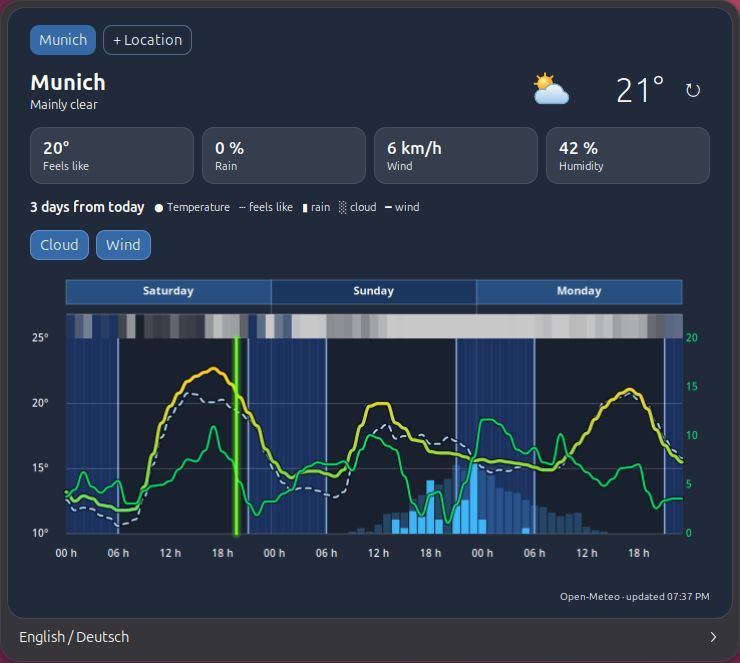

# Wetterkurve

Wetterkurve brings a compact three-day weather forecast to GNOME Shell,
Windows 11, Android, and iPhone. Save up to three locations and see temperature,
feels-like temperature, rain probability, and rainfall at a glance.

On GNOME, current conditions appear in the top panel and the chart opens in
a popup. Windows provides a temperature tray icon and chart window. Android
provides current-conditions, six-hour, and three-day chart widgets. The iPhone
app offers the same three widget sizes through WidgetKit.

Forecasts and location search come directly from the [Open-Meteo API](https://open-meteo.com/).
No API key is required.



## Features

- Current conditions and temperature in the top panel
- Save and switch between up to three locations
- Live location search
- Temperature and feels-like curves plus precipitation information
- Automatic refresh every 20 minutes and a manual refresh button
- English by default, with optional German selected in the app
- Optional cloud-cover, wind, and feels-like layers

## Install

1. Download `wetterkurve@wean.de.shell-extension.zip` from the
   [latest GitHub release](https://github.com/vibecodingwean/wetterkurve/releases/latest).
2. Install it from a terminal:

   ```bash
   gnome-extensions install --force ~/Downloads/wetterkurve@wean.de.shell-extension.zip
   ```

3. Enable **Wetterkurve** in the GNOME **Extensions** app.

On Wayland, log out and back in once if GNOME Shell does not discover the
extension immediately.

## Windows 11

The same Open-Meteo forecast runs on Windows 11 as a tray app, analogous to the
GNOME panel indicator: the current temperature stays near the clock, and a
click opens the three-day chart. Windows Widgets cannot replace that taskbar
weather button, so Wetterkurve is not installed into the Widgets Board.

On a Windows 11 machine with the .NET 10 SDK:

```powershell
.\windows\install.ps1 -LaunchDesktop
```

This publishes `Wetterkurve.exe` to `%LOCALAPPDATA%\Wetterkurve\app`. Closing
the window hides it in the notification area; a left-click restores it.

Generated Windows binaries are not stored in Git. Build from source with the
instructions above.

## Android

The same Open-Meteo forecast runs on Android as home screen widgets. The app
stores up to three locations and offers current conditions, a six-hour forecast,
and a three-day chart. The [Google Play listing](https://play.google.com/store/apps/details?id=com.wetterkurve)
provides the production release.

On a machine with JDK 21 and an Android SDK (API 36):

```bash
cd android
./gradlew :core:test :app:testDebugUnitTest :app:assembleDebug
```

Install `android/app/build/outputs/apk/debug/app-debug.apk`, then add a
**Wetterkurve** widget from the launcher widget picker. Details are in
[`android/README.md`](android/README.md).

## Language

Wetterkurve starts in English, regardless of your system language. Your choice
is saved and applies to weather labels, location search, and chart weekdays.

- **GNOME:** open the popup and choose **English / Deutsch**.
- **Android:** choose **English** or **Deutsch** at the top of the app;
  the widgets use the same language.
- **Windows:** right-click the temperature tray icon and choose
  **English / Deutsch**.
- **iPhone:** choose **English** or **Deutsch** in the app; widgets use the
  saved choice.

## iPhone

The native SwiftUI app and WidgetKit extension are in [`ios/`](ios/). See
[`ios/README.md`](ios/README.md) for Xcode build and Simulator checks.

### Development install

```bash
./install.sh
```

This creates a development symlink instead of installing a release ZIP.

## Develop and package

```bash
./test.sh
```

This compiles the local GSettings schema, runs the tests, and creates
`dist/wetterkurve@wean.de.shell-extension.zip`.

## Release

1. Run `./scripts/release.sh` with the .NET 10 SDK to test and build the
   GNOME ZIP and Windows x64 desktop ZIP from the current source. Build
   Android separately with JDK 21 and an Android SDK.
2. Tag the tested commit as `vX.Y.Z`. After reviewing the packages, create
   a GitHub release and attach each artifact cleared for publication. Android
   APKs are not distributed through GitHub.
   The tag workflow verifies the source; it does not publish packages.
3. Submit a tested tag to extensions.gnome.org manually through the protected
   **Submit Wetterkurve to GNOME Extensions** workflow.

Configure the `EGO_USERNAME` and `EGO_PASSWORD` secrets only in that protected
GitHub environment. Details and the first-release checklist are in
[docs/PUBLISHING.md](docs/PUBLISHING.md).

## License

MIT. See [LICENSE](LICENSE).

## Website and tutorial

Explore the app and its German tutorial at [app.wean.de/wetterkurve](https://app.wean.de/wetterkurve/). Website source lives in `website/`; video binaries are hosted separately.
